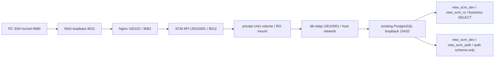

# 4-2H NAS 격리 실행 준비 — 독립 인증 기준

4-2I에서 적용 전·후 검증과 복구 실험을 보완했습니다. [최신 검증 결과·승인 순서](SCM_NAS_4_2I_VERIFICATION.md)를 먼저 따르며, 아래 기동 명령은 적용 후 PASS와 별도 실행 승인이 모두 확보된 경우에만 사용합니다. 4-2I baseline을 쓰면 capture/compare 양쪽에 동일한 `--file runtime/4-2h/4-2i-before-start.json`을 지정합니다.

현재 문서는 자산관리 handoff 기반의 이전 준비안을 대체합니다. [독립 운영 전환/DB 준비 절차](SCM_STANDALONE_4_2H.md)를 먼저 따릅니다. 실제 NAS 서비스 실행/DB 변경/Commit/Push는 이번 작업에서 하지 않았습니다.

## 실행 가능성 및 영향

| 항목 | 준비된 구성 | NAS 승인 후 확인 |
|---|---|---|
| 접속 | 전용 `new-scm-4-2h`, 127.0.0.1:8011 → Nginx 8081 | 기존 8011 충돌 없음, LAN 비공개/SSH 터널 |
| 인증 | SCM 자체 로그인, 외부 identity/handoff 호출 없음 | 승인된 기존 관리자에게 SCM 전용 비밀번호 설정 |
| API | UID 10001, 내부 8012만, host port 없음 | Nginx→FastAPI, 독립 login/logout/401/403 |
| DB | 업무는 new_scm_ro, 인증은 new_scm_auth, new_scm_dev만 | revision 0014, 기존 public 54개, auth 역할 최소 권한 |
| Relay | UID 10001, host network, loopback 15432 upstream | 기존 asset-postgres 변경 없이 접속, DB 읽기/인증 쓰기 분리 |
| Unix socket | 전용 named volume, relay RW/backend RO, 디렉터리·socket 700 | 신규 volume copy-up 소유권 10001:10001, socket 연결 |
| 보안 | read-only, cap-drop=ALL, no-new-privileges, 비루트, tmpfs | 실제 이미지/마운트/UID, Docker socket/env 파일 mount 없음 |
| 자원 | relay64/backend256/frontend128 MiB, restart=no | 메모리 여유 및 MemoryLimit 지원, Argon2 동시 2개 사용량 |

CPU CFS/PID 제한 미지원 NAS에서 테스트 프로파일은 CPU/PID 옵션을 지정하지 않습니다. 이는 완전한 자원 격리가 아닙니다. 메모리 448 MiB는 합산 상한이며 예약/성능 보장이 아닙니다. 호스트 CPU·PID·공유 PostgreSQL 연결 부하는 남고 relay 연결 수 자체에 하드 상한도 없습니다. 기존 서비스 여유가 불충분하면 기동하지 않습니다.



자산관리 3010/8010 HTTP 서비스의 가동 여부는 SCM 준비 조건이 아닙니다. 기존 리스너가 있으면 그대로 fingerprint에 포함하며 전후 변화는 중단 사유입니다. 공유 PostgreSQL은 여전히 DB 인프라이므로 정상 상태와 loopback 15432를 검사합니다.

Docker Engine 28 미만은 localhost 게시 포트의 동일 L2 접근 위험이 있어 단순 loopback 바인딩만으로 외부 차단을 단정하지 않습니다. 엔진 버전이 낮거나 불명확하면 **이미 존재하는 네트워크 차단 증빙**이 있어야 하며 이번 작업에서 방화벽/daemon/커널을 변경하지 않습니다. 증빙이 없으면 테스트 승인 불가입니다. [Docker 공식 설명](https://docs.docker.com/engine/network/port-publishing/)

## 승인 전 체크리스트

- [ ] 별도 실제 실행 승인. 기존 서비스/DB 변경 권한으로 확대 해석하지 않음.
- [ ] 독립 인증 0014, 별도 auth 역할, 사용자/기존 해시/매핑 보존 및 백업·복구 검증 승인/완료.
- [ ] 승인된 SCM 관리자 초기 비밀번호 설정, 정상/일반 사용자 테스트 계정과 최소 메뉴/작업 권한.
- [ ] 기존 `.env` 보존. 새 `.env.standalone`은 일반 사용자 소유 600, URL 두 개 같은 대상, legacy 키 제거.
- [ ] 신뢰할 수 있는 같은 소스의 검증/백엔드/Nginx 이미지 사전 반입; NAS에서 임의 build/pull 금지.
- [ ] `.nas-test-images.env`에 불변 sha256 이미지 ID 2개, 소유자 600, Git 제외.
- [ ] new-scm-4-2h의 이름 충돌 없음. 프로젝트 전용 volume/network만 사용.
- [ ] 설정 preflight 및 protected_state check-config PASS.
- [ ] 8011 비어 있음. Engine/L2 비공개 증빙 및 CPU/PID 미지원 잔여 영향 승인.
- [ ] 메모리/CPU/프로세스/DB 연결 여유와 운영 보안 로그 보존 정책 검토.
- [ ] 보호 baseline capture PASS. 기존 서비스 상태와 PostgreSQL ID/시작시각/재시작횟수/포트/네트워크 보존.
- [ ] 오류 시 즉시 신규 프로젝트만 중지하고 승인 담당자에게 고정 코드 보고.

## 조회 명령 — 컨테이너 시작 없음

일반 사용자 터미널의 `new-scm` 디렉터리에서:

```sh
PYTHONDONTWRITEBYTECODE=1 python3 deploy/preflight.py --env-file .env.standalone --config-only
PYTHONDONTWRITEBYTECODE=1 python3 deploy/protected_state.py check-config --env-file .env.standalone
sudo -v
PYTHONDONTWRITEBYTECODE=1 python3 deploy/protected_state.py capture --env-file .env.standalone --docker-sudo
```

capture는 `runtime/4-2h/protected-before.json`을 600으로 새로 생성하며 덮어쓰지 않습니다. 디렉터리는 700입니다. snapshot에는 비밀번호·인증 키·DB URL·Docker inspect Env가 없으며 선택한 상태/파일의 fingerprint만 기록합니다. 과거 baseline과 혼용하지 말고 승인된 새 `--file runtime/4-2h/<실행ID>.json`을 사용합니다. compare에도 동일한 --file/--env-file을 지정합니다.

## 실제 기동·중지 — 아래는 별도 승인 후에만

승인 전에는 실행하지 않습니다. Docker CLI 오류 원문은 화면에 표시하지 않으며 config 원문/전체 inspect/logs를 출력하지 않습니다. 아래 함수의 stderr를 캡처/비공개 처리하는 이유도 비밀값 노출 방지입니다.

```sh
export SCM_ENV_FILE="$PWD/.env.standalone"
dc() {
  sudo -n docker --host=unix:///var/run/docker.sock compose \
    --project-name new-scm-4-2h --env-file "$PWD/.env.standalone" \
    --env-file "$PWD/.nas-test-images.env" -f deploy/compose.nas-test.yaml "$@" 2>/dev/null
}
abort_test() { dc stop -t 10 >/dev/null || printf 'FAIL nas_test_stop_failed\n'; }
compare_state() {
  PYTHONDONTWRITEBYTECODE=1 python3 deploy/protected_state.py compare --env-file .env.standalone --docker-sudo
}
dc config --quiet || { printf 'FAIL nas_test_config\n'; exit 1; }
compare_state || exit 1
dc up -d --no-build --pull never db-relay || { abort_test; exit 1; }
compare_state || { abort_test; exit 1; }
dc up -d --no-build --pull never backend || { abort_test; exit 1; }
for probe in socket database auth health; do
  dc exec -T backend python -B -m app.core.nas_check "$probe" || { abort_test; exit 1; }
done
compare_state || { abort_test; exit 1; }
dc up -d --no-build --pull never frontend || { abort_test; exit 1; }
PYTHONDONTWRITEBYTECODE=1 python3 deploy/protected_state.py check-http || { abort_test; exit 1; }
compare_state || { abort_test; exit 1; }
```

사용자 PC의 9680 SSH 터널로만 접속해 SCM 전용 로그인·로그아웃·세션 만료·일반 계정의 관리자 API 403을 확인합니다. 자산관리의 실제 운영 서비스를 중지해서 독립성을 시험하지 않습니다. 외부 인증 HTTP를 차단/미사용하는 독립 로컬 자동 테스트로 의존성 제거를 확인하고 NAS에서는 기존 서비스 상태를 그대로 유지합니다.

상태 확인은 `dc ps --all`의 새 프로젝트만 대상으로 합니다. 오류 시 위 abort_test로 신규 서비스만 중지하고 compare_state를 실행합니다. 실패를 우회하려고 sudo Python, 권한 완화, 강제 마이그레이션, PostgreSQL/기존 서비스 재시작을 하지 않습니다.

```sh
dc stop -t 10 >/dev/null || printf 'FAIL nas_test_stop_failed\n'
compare_state
# 컨테이너/전용 네트워크 정리까지 승인된 경우에만; DB/socket volume은 보존
dc down --timeout 10 >/dev/null || printf 'FAIL nas_test_cleanup_failed\n'
compare_state
```

`down -v`, --remove-orphans, docker prune, 기존 프로젝트 compose, 컨테이너 전체 stop/rm은 금지합니다. rollback은 새 프로젝트 중지 + 이전 승인 이미지/설정 복원만 수행하며 DB schema/data rollback은 별도 백업/복구 승인이 필요합니다. 0014의 자동 downgrade는 차단됩니다.
